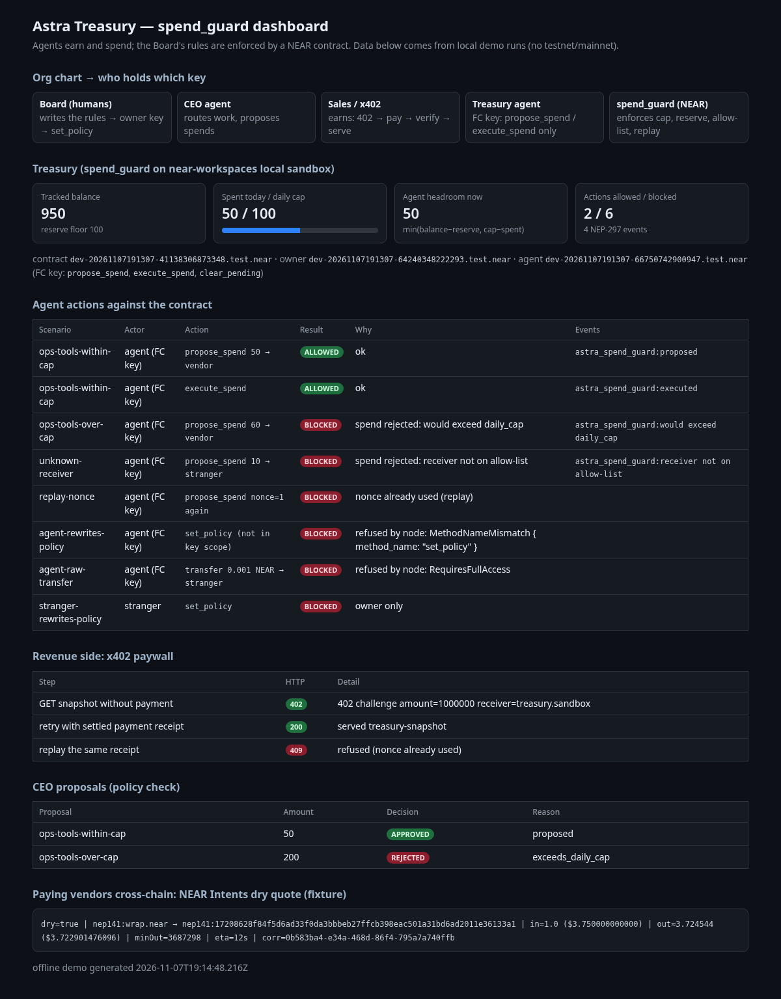

# Astra Treasury (built at NEAR HACKATHON)

Astra is a company run by AI agents. Humans (the Board) only write the rules. This repo turns those rules into a NEAR contract, `spend_guard`, so an agent can earn and spend without overspending, without borrowing, and without signing anything outside its key's scope.

**Quick start (fresh clone, Node ≥ 22, pnpm; Rust stable for the on-chain part):**
```bash
pnpm install
pnpm demo            # offline: x402 402→200→409 loop, CEO policy checks, NEAR Intents dry quote (fixture)
pnpm demo:sandbox    # builds spend_guard wasm, boots a local NEAR sandbox node, runs the agent scenario
pnpm dashboard       # renders dashboard/out/index.html from the two runs above
```



## Do X → see Y

| Do | You should see |
|----|----------------|
| `pnpm demo:sandbox` | spend_guard is deployed to a local `near-workspaces` sandbox. The agent signs with a **function-call key** limited to `propose_spend / execute_spend / clear_pending`. Output table: the 50-yocto spend is `OK` (proposed → executed → transferred); 60 more is `BLOCKED would exceed daily_cap`; a non-allow-listed receiver is `BLOCKED`; a reused nonce is `BLOCKED (replay)`; the agent's key calling `set_policy` is refused by the node with `MethodNameMismatch`; a raw NEAR transfer with that key is refused with `RequiresFullAccess`; a stranger calling `set_policy` gets `owner only`. Final `balance=950 spent_today=50`. |
| `pnpm test:sandbox` | 4 integration tests pass on the local sandbox, including "vendor balance rises by exactly 50 yocto" and "only the contract can call its own callback". |
| `pnpm test:rust` | 14 spend_guard unit tests (cap, reserve, allow-list, replay, owner-only, UTC day roll, refund on failed transfer). |
| `pnpm demo` | Section 1: unpaid request → `402` with amount/receiver/nonce; paid retry → `200` snapshot; same receipt again → `409` (replay). Section 2: CEO proposals, one approved, one rejected `exceeds_daily_cap`. Section 3: a NEAR Intents 1Click quote with `dry=true` (recorded fixture). |
| `ASTRA_INTENTS_LIVE=1 pnpm quote:live` | A live read-only `dry:true` quote from `1click.chaindefuser.com` (no deposit address is used, nothing is signed). |
| `pnpm test` | TypeScript tests for x402, agents, intents, dashboard (Node test runner). |
| `pnpm dashboard`, then open `dashboard/out/index.html` | Org chart (who holds which key), treasury cards (balance, spent/cap, agent headroom), each agent action with its result and NEP-297 events, the x402 loop, and the Intents quote. |

## How it fits together
```
external agent ──HTTP──> x402/ paywall ── 402 {amount, receiver, nonce} ──> pays ──> receipt verified ──> 200 data
                                                                                        │ revenue
agents/ CEO ── propose_spend ──> contracts/spend_guard (NEAR) ── execute_spend ──> NEAR transfer to allow-listed vendor
   (FC key: propose/execute/clear only)   checks: allow-list · daily cap · balance − reserve · nonce
                                          owner-only: set_policy · credit      events: EVENT_JSON (NEP-297)
intents/ ── dry quote for paying a vendor cross-chain (read-only)          dashboard/ ── renders the event log
```
Details: [docs/ARCHITECTURE.md](docs/ARCHITECTURE.md) · [docs/THREAT_MODEL.md](docs/THREAT_MODEL.md) · [HACKATHON.md](HACKATHON.md)

## Tracks
- **Autonomous Business**: an agent org whose treasury rules are code; revenue via x402, vendor payments via spend_guard, cross-chain pricing via NEAR Intents.
- **Agent Economy**: the x402 paywall loop (402 → pay → verify → serve, replay-safe).
- **AI Security & Defense**: spend_guard plus NEAR function-call access keys. Agent keys physically cannot call owner methods or move NEAR directly; this is shown on a real (local) NEAR node, not only in mocks.

## NEAR features used
- Rust contract on `near-sdk` 5.x, cross-contract promise + `#[private]` callback
- Function-call access keys with method allow-list and gas allowance
- NEP-297 event logs
- `near-workspaces` sandbox for deploy + integration tests
- NEAR Intents 1Click API (`dry:true` quotes only)

## Board rules compiled into the contract
1. Never spend more than `budget − reserve`
2. Daily spend cap (UTC day bucket)
3. Receiver allow-list
4. Nonce / replay guard (a nonce is burned even if the transfer fails)
5. **No** borrow / loan / leverage methods exist
6. Only the owner can change policy or credit the budget; agents hold FC keys limited to propose/execute/clear

## Honest scope / limits
- Everything runs locally: unit tests, a local `near-workspaces` sandbox, and recorded Intents fixtures. **Nothing is deployed to testnet or mainnet**, and no real funds move.
- `balance` in spend_guard is a **budget the owner credits**; `execute_spend` then sends that amount of real NEAR (sandbox NEAR in the demo) from the contract account. If the contract account cannot cover it, the callback refunds the budget.
- The x402 paywall verifies receipts against a mock RPC in the demo; the CEO agent in `agents/` uses a TypeScript mirror of the contract's checks (the on-chain path is in `sandbox/`).
- Intents is quote-only (`dry:true`); no deposits or swaps.

## Network policy
No mainnet signing from this project. Prize / payout address (documented only, never signed from):
`de3d2cde06132391a0a6090759c515f0649c4a608530baffd9dd8149ba587417`

## Repo layout
| Path | What |
|------|------|
| `contracts/spend_guard` | Rust contract + unit tests |
| `sandbox/` | `near-workspaces` harness: integration tests + `sandbox_demo` runner (writes `dashboard/data/sandbox_run.json`) |
| `x402/` | Paywall: 402 challenge, nonce store, receipt verify, snapshot |
| `agents/` | CEO proposals against a TS mirror of the policy |
| `intents/` | 1Click dry-quote client, fixture, offline tests, live smoke |
| `dashboard/` | Static HTML renderer + tests |
| `scripts/` | `demo.ts`, `build-wasm.sh` |

## License
MIT
